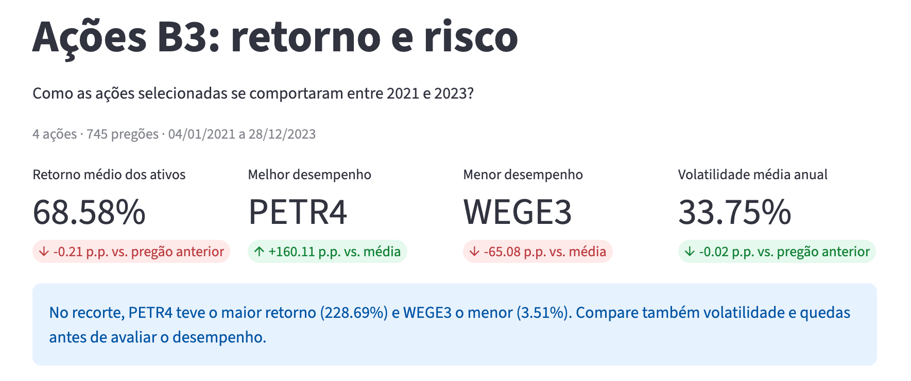
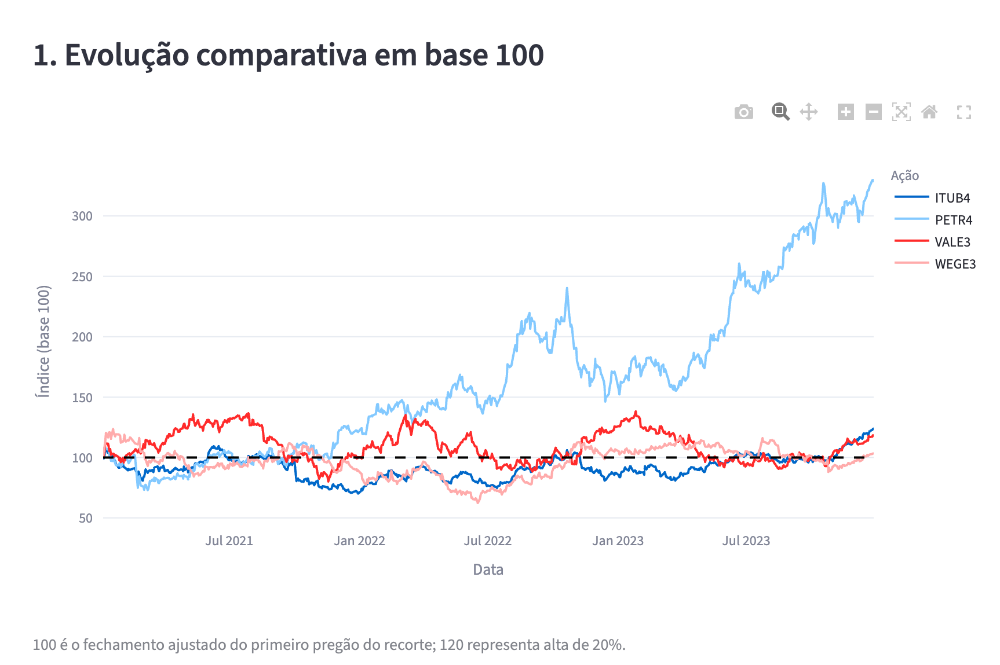
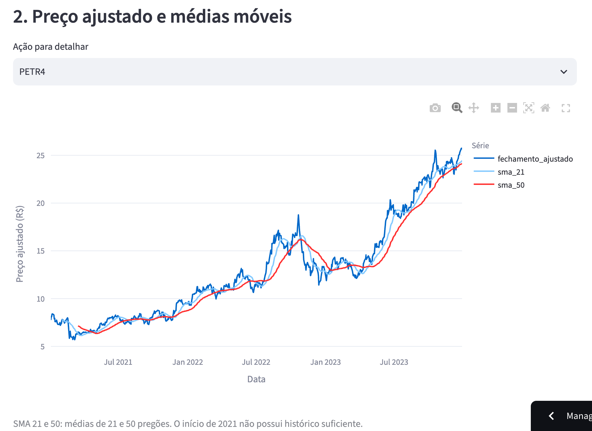
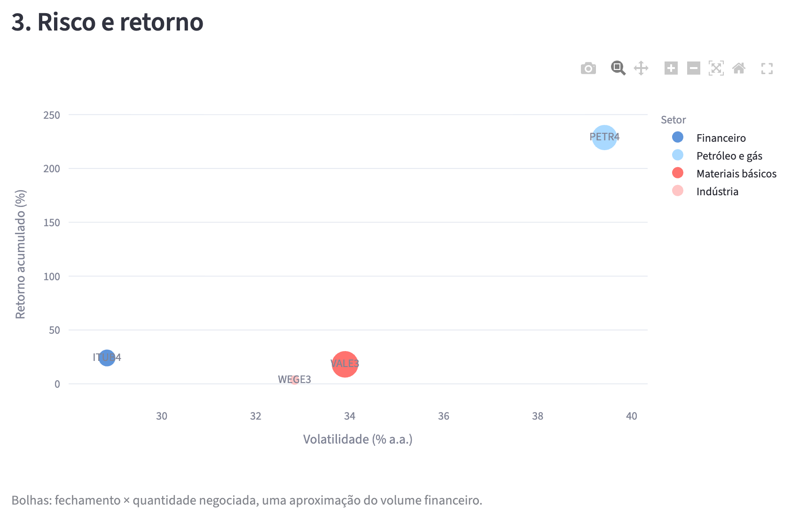
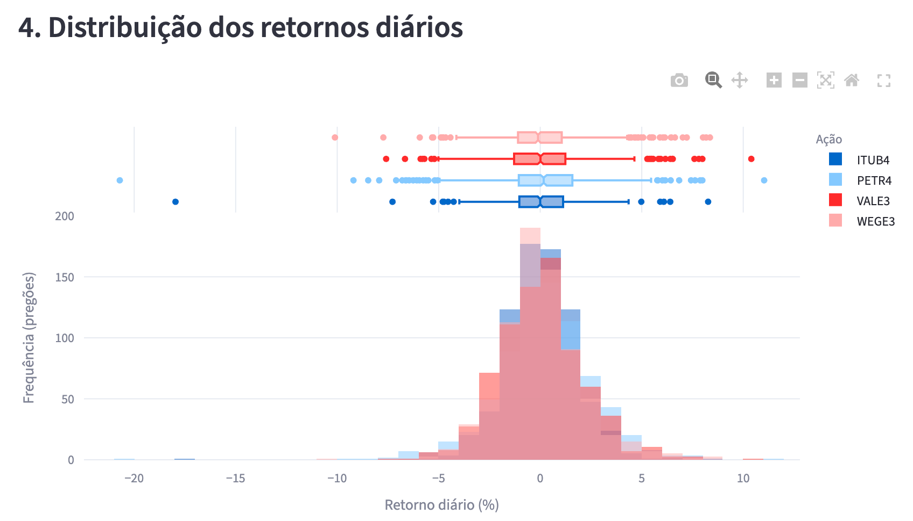
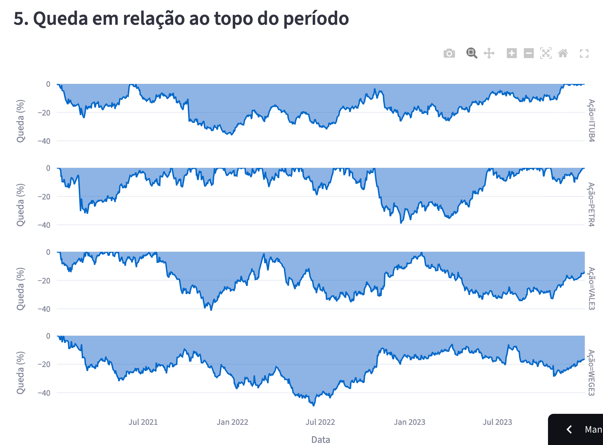
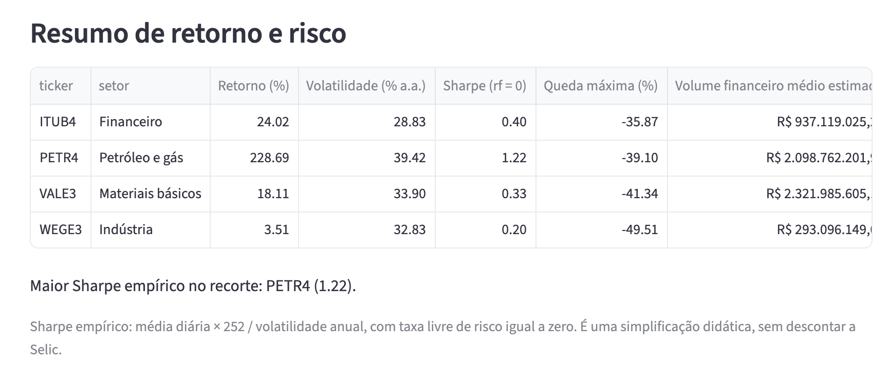
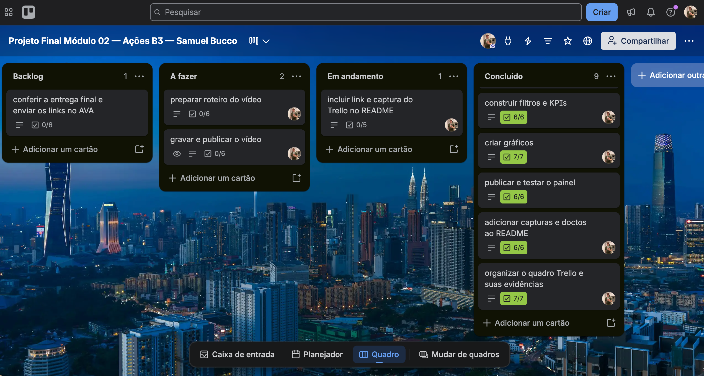

# Ações B3: retorno e risco de 2021 a 2023

Projeto final do módulo 02 de Visualização de Dados e Business Intelligence, na linha 2 do roteiro. O painel compara oito ações por retorno ajustado, volatilidade, distribuição dos retornos, drawdown e médias móveis, usando os componentes de Streamlit apresentados nas aulas.

## Contexto e perguntas de negócio

Uma alta acumulada não informa, sozinha, o risco enfrentado pelo investidor. O objetivo é comparar o desempenho histórico e a intensidade das oscilações no mesmo período.

1. Quanto cada ação rendeu no recorte, partindo de uma base comum de 100?
2. Quais ações combinaram maior retorno e menor volatilidade? Qual teve o maior Sharpe empírico?
3. Como os retornos diários se distribuíram e quais tiveram oscilações extremas?
4. Qual foi a maior queda desde o topo de cada ativo?
5. Como o preço ajustado se comportou em relação às médias de 21 e 50 pregões?

## Fonte, período e uso dos dados

- Provedor: **Yahoo Finance**, por meio de `yfinance`, alternativa prevista no roteiro. Não é uma extração direta da B3 nem uma API oficial da bolsa.
- Intervalo solicitado: 01/01/2021 a 31/12/2023. Os pregões retornados vão de **04/01/2021 a 28/12/2023**.
- Amostra: **ABEV3, EGIE3, GGBR4, ITUB4, PETR4, RENT3, VALE3 e WEGE3**. São oito dos ativos sugeridos, escolhidos para manter um escopo didático.
- Coleta: `yf.download`, com sufixo `.SA`, `auto_adjust=False` e fim exclusivo em `2024-01-01`. O fechamento ajustado vem da coluna `Adj Close`, sem ajuste manual adicional.
- O registro da extração está em [data/raw/origem.json](data/raw/origem.json). O provedor pode revisar retroativamente preços e ajustes; o CSV bruto preserva a coleta usada nesta análise.
- Os dados seguem os termos do Yahoo Finance, sem pressupor uma licença aberta de redistribuição. O projeto tem finalidade educacional e pessoal. A licença da biblioteca não equivale a uma licença dos dados; consulte a [orientação do yfinance e os termos vinculados](https://ranaroussi.github.io/yfinance/).

Os setores são agrupamentos didáticos fixos, definidos em `src/etl.py`, e não uma reprodução da classificação setorial oficial da B3.

## Pipeline de dados e modelo SQL

1. **Extração:** coleta as oito séries e registra a origem e os parâmetros.
2. **Limpeza:** lê/grava CSV em UTF-8, padroniza ticker, converte datas e campos numéricos, elimina nulos, infinitos, duplicatas e valores incompatíveis com preços e volume.
3. **Validação:** exige a presença dos oito ativos e cobertura no início de 2021 e fim de 2023; não inventa cotações para datas ausentes. Verifica a coerência entre abertura, fechamento, mínima e máxima.
4. **Transformação:** estima volume financeiro por fechamento × quantidade negociada. Calcula retorno diário, base 100, drawdown, volatilidade, Sharpe e médias móveis.
5. **Saída:** salva a base tratada e os CSVs `dim_ativos.csv` e `fato_cotacoes.csv` para importação no banco.

A coleta atual contém **5.960 registros**, com **745 pregões por ação**; nenhum registro foi removido na limpeza. Tratar dados não significa necessariamente descartar linhas: os critérios são aplicados mesmo quando não há falhas.

O modelo dimensional simples tem `dim_ativos` (chave: ticker) e `fato_cotacoes` (chave composta: ticker, data). A view `cotacoes_b3` faz o JOIN usado pelo app. O esquema está em [src/modelo.sql](src/modelo.sql).

## Dicionário de dados

| Campo                      | Tipo                | Significado / cálculo                                                               |
| -------------------------- | ------------------- | ------------------------------------------------------------------------------------ |
| data                       | datetime / SQL DATE | Data do pregão                                                                      |
| ticker                     | string              | Código local da ação, sem `.SA`                                                 |
| setor                      | string              | Agrupamento econômico didático                                                     |
| abertura                   | float               | Preço de abertura fornecido pelo Yahoo, em R$                                       |
| maxima                     | float               | Maior preço do dia fornecido pelo Yahoo, em R$                                      |
| minima                     | float               | Menor preço do dia fornecido pelo Yahoo, em R$                                      |
| fechamento                 | float               | Close do provedor, sem ajuste adicional por dividendos; pode refletir desdobramentos |
| fechamento_ajustado        | float               | Adj Close do provedor; base dos cálculos de desempenho                              |
| volume                     | int                 | Quantidade negociada segundo o provedor; não representa reais                       |
| volume_financeiro_estimado | float               | fechamento × volume, aproximação em R$, não o giro financeiro oficial            |
| retorno_diario             | float               | `(preço ajustado / preço ajustado anterior - 1) × 100`                          |
| base_100                   | float               | `preço ajustado / primeiro preço ajustado do recorte × 100`                     |
| drawdown                   | float               | `(preço ajustado / máximo ajustado acumulado - 1) × 100`                        |
| sma_21 / sma_50            | float               | Média de 21 / 50 pregões do fechamento ajustado                                    |
| retorno_acumulado          | float               | `(último ajustado / primeiro ajustado - 1) × 100`                                |
| volatilidade_anual         | float               | Desvio padrão amostral do retorno diário decimal × √252 × 100                   |
| sharpe_rf_zero             | float               | Média do retorno diário decimal × 252 / volatilidade anual decimal; rf = 0        |
| drawdown_maximo            | float               | Menor drawdown no recorte, em %                                                      |
| volume_medio_estimado      | float               | Média diária do volume financeiro estimado, em R$                                  |

O primeiro retorno de cada recorte é nulo por não haver observação anterior dentro do filtro. As primeiras 20 e 49 observações de 2021 não têm SMA 21 e SMA 50 completas. Esses nulos dos indicadores são esperados.

## Tecnologias e relação com as aulas

| Tecnologia / recurso                                       | Uso                                                   |
| ---------------------------------------------------------- | ----------------------------------------------------- |
| Python e Pandas                                            | Limpeza, filtros e cálculos em funções curtas      |
| yfinance                                                   | Extração das séries históricas fora do dashboard  |
| Streamlit                                                  | Interface e publicação no Community Cloud           |
| `st.cache_data(ttl=600)`                                 | Cache da consulta SQL e da leitura/tratamento do CSV  |
| `st.session_state`                                       | Persistência dos filtros e callback de restauração |
| `st.sidebar`, `st.columns`, `st.metric`, `st.tabs` | Organização nativa do painel                        |
| Plotly Express                                             | Cinco gráficos interativos                           |
| `st.dataframe`, `st.download_button`                   | Consulta e exportação dos dados filtrados           |
| SQLAlchemy e psycopg                                       | Conexão opcional ao PostgreSQL via `st.connection` |

## Resultados e evidências numéricas

Resultados do intervalo completo, para **as oito ações**, calculados a partir da coleta registrada em `origem.json`. O painel inicia com quatro ações, então os KPIs iniciais são diferentes da média das oito.

| Ação | Retorno acumulado | Volatilidade anual | Drawdown máximo | Sharpe (rf = 0) |
| ------ | ----------------: | -----------------: | ---------------: | --------------: |
| ABEV3  |             2,57% |             25,46% |          -31,42% |            0,16 |
| EGIE3  |            25,35% |             18,76% |          -17,65% |            0,50 |
| GGBR4  |            30,79% |             35,56% |          -33,93% |            0,43 |
| ITUB4  |            24,02% |             28,83% |          -35,87% |            0,40 |
| PETR4  |           228,69% |             39,42% |          -39,10% |            1,22 |
| RENT3  |            -0,25% |             36,89% |          -38,40% |            0,18 |
| VALE3  |            18,11% |             33,90% |          -41,34% |            0,33 |
| WEGE3  |             3,51% |             32,83% |          -49,51% |            0,20 |

PETR4 apresentou o maior retorno e Sharpe simplificado, mas também a maior volatilidade anual da amostra. EGIE3 teve a menor volatilidade e o drawdown menos intenso. WEGE3 terminou acima do preço ajustado inicial, apesar de sofrer uma queda de 49,51% desde um topo durante o período. Essas diferenças mostram por que retorno final e risco durante o caminho devem ser examinados juntos.

A distribuição dos retornos também não foi simétrica em todos os ativos: PETR4 teve assimetria de aproximadamente -0,87 e ITUB4 de -1,12. Esses valores descrevem a amostra e não permitem prever a próxima oscilação. Os resultados por ativo estão em [notebooks/resumo_ativos.csv](notebooks/resumo_ativos.csv), reproduzíveis pela análise exploratória.

## Limitações e decisões de negócio

O painel apoia a triagem histórica de ativos, a comparação de exposição a oscilações e a avaliação de quedas que um investidor precisaria suportar. A leitura executiva segue contexto, evidência e próximo passo: identificar desempenho, comparar risco e investigar os fatores econômicos antes de tomar uma decisão.

A amostra é pequena e selecionada entre empresas conhecidas, não representa toda a bolsa e pode conter viés de sobrevivência. O volume financeiro é estimado, não o total financeiro informado pela B3. O Sharpe assume taxa livre de risco zero, portanto não mede o excesso de retorno sobre a Selic. Custos, tributos e inflação não entram nos resultados. Os preços ajustados dependem das regras e revisões do provedor.

O retorno médio corresponde à média simples dos retornos acumulados, equivalente a pesos iniciais iguais quando os pregões são comuns. **Volatilidade média dos ativos não é volatilidade da carteira**, pois não inclui covariâncias. As comparações usam apenas datas com cotação para todas as ações selecionadas. Base 100, drawdown e retornos reiniciam no início do filtro; as médias móveis aproveitam o histórico disponível desde 2021.

As associações e movimentos dos gráficos descrevem o passado. Não demonstram causalidade nem garantem resultados futuros.

## Demonstração e navegação

Aplicação publicada: [Ações B3 — retorno e risco](https://samuel-bucco-projeto-final-b3.streamlit.app/).

Status: versão local verificada com o AppTest do Streamlit e revisada visualmente em 18/10/2026, após ajustes no eixo do gráfico de drawdown e na formatação do volume financeiro. Na mesma data, o estudante confirmou na versão publicada a fonte Supabase, os filtros, a restauração e o download do CSV. As capturas abaixo registram o painel com ITUB4, PETR4, VALE3 e WEGE3 selecionadas, de 2021 a 2023.

Os deltas de retorno e volatilidade comparam com o cálculo até o pregão anterior. Os deltas dos ativos de melhor e menor desempenho mostram a diferença para o retorno médio das ações selecionadas, em pontos percentuais.

### Indicadores do recorte



### Desempenho





### Risco







### Resumo de retorno e risco



## Como executar localmente

Use Python **3.13 ou 3.14**. A verificação local foi feita com Python 3.14.

```bash
git clone https://github.com/samuelbucco/Projeto_Final_Mod_02_B3.git
cd Projeto_Final_Mod_02_B3
python3 -m venv .venv
source .venv/bin/activate
python -m pip install -r requirements.txt
python -m streamlit run app.py
```

No Windows, crie o ambiente com `python -m venv .venv` e ative com `.venv\Scripts\Activate.ps1` no PowerShell.

O CSV já acompanha o projeto; não é preciso baixar novamente para abrir o painel. Para reproduzir o tratamento e a análise sem rede:

```bash
python -m src.etl --local
python -m notebooks.analise_exploratoria
```

Para uma nova coleta, execute `python -m src.etl`. Isso substitui a base e pode alterar números, devido a revisões do provedor.

### Conexão opcional ao Supabase

Execute `src/modelo.sql` no editor SQL do Supabase. Importe primeiro `data/processed/dim_ativos.csv` em `dim_ativos` e depois `data/processed/fato_cotacoes.csv` em `fato_cotacoes`. Copie `.streamlit/secrets.toml.example` para `.streamlit/secrets.toml` e preencha os dados reais. No Cloud, use o painel de Secrets, sem versionar credenciais.

O app tenta ler a view com `st.connection("postgresql", type="sql")`; se não conseguir, usa o CSV local. A conexão real ao Supabase foi configurada e validada em 17/10/2026: oito ativos, 5.960 cotações e a view acessível. As credenciais ficam somente no arquivo local ignorado pelo Git; no deploy, devem ser configuradas nos Secrets do Streamlit Cloud.

### Publicação no Streamlit Community Cloud

Após revisar e enviar o código ao GitHub, siga o [guia oficial de deploy](https://docs.streamlit.io/deploy/streamlit-community-cloud/deploy-your-app/deploy): selecione este repositório, a branch `main` e o arquivo `app.py`, com Python 3.13. O painel funciona sem Secrets usando o CSV. Depois registre o endereço real, teste os filtros em produção e inclua capturas da tela nesta documentação.

## Estrutura

```text
app.py                          # Interface Streamlit
src/dados.py                    # Leitura, cache e contingência
src/indicadores.py              # Cálculos em Pandas
src/etl.py                      # Coleta e tratamento reproduzíveis
src/modelo.sql                  # Dimensão, fato e view PostgreSQL
data/raw/                      # Coleta original e metadados
data/processed/                # Base tratada e arquivos para SQL
notebooks/analise_exploratoria.py # EDA reproduzível em script
notebooks/resumo_ativos.csv     # Evidências calculadas
docs/                          # Roteiro do curso e guias do projeto
.streamlit/                    # Tema e exemplo de Secrets
requirements.txt               # Dependências
```

## Gestão ágil e links

| Entrega                        | Link / estado                                                                    |
| ------------------------------ | -------------------------------------------------------------------------------- |
| Repositório                   | [Projeto_Final_Mod_02_B3](https://github.com/samuelbucco/Projeto_Final_Mod_02_B3) |
| Aplicação no Streamlit Cloud | [Abrir painel](https://samuel-bucco-projeto-final-b3.streamlit.app/)              |
| Quadro Trello público         | [Abrir quadro do projeto](https://trello.com/b/PZlWa64C/projeto-final-modulo-02-acoes-b3-samuel-bucco) |
| Captura do quadro Trello       | [Ver captura](docs/imagens/trello.png)                                            |
| Vídeo de 3 a 5 minutos        | Pendente de gravação / link                                                    |

O planejamento está em [docs/planejamento.md](docs/planejamento.md). Use `main` para a versão estável, `develop` para integração e `feature/*` para cada etapa, preservando as branches após os merges. Movimente somente um card por vez para Em andamento.



## Autoria, estudo e referências

Aluno: **Samuel Bucco**. Esta versão foi preparada com assistência de IA para implementação, documentação e verificação. O [guia de estudo](docs/guia_de_estudo.md) organiza os conceitos e exercícios para revisar e adaptar a solução.

- Roteiro de avaliação do módulo: `docs/Roteiro Projeto Final.pdf`.
- [Aplicação de referência das aulas, Semana 11](https://github.com/Visualizacao-Dados-BI-T2/M2_Semana_11).
- [Documentação do yfinance](https://ranaroussi.github.io/yfinance/) e [parâmetros de download](https://ranaroussi.github.io/yfinance/reference/api/yfinance.download.html).
- [Streamlit: cache de dados](https://docs.streamlit.io/develop/api-reference/caching-and-state/st.cache_data), [estado](https://docs.streamlit.io/develop/api-reference/caching-and-state/st.session_state) e [conexões](https://docs.streamlit.io/develop/api-reference/connections/st.connection).
- [Plotly Express](https://plotly.com/python/plotly-express/) e [Pandas](https://pandas.pydata.org/docs/).
